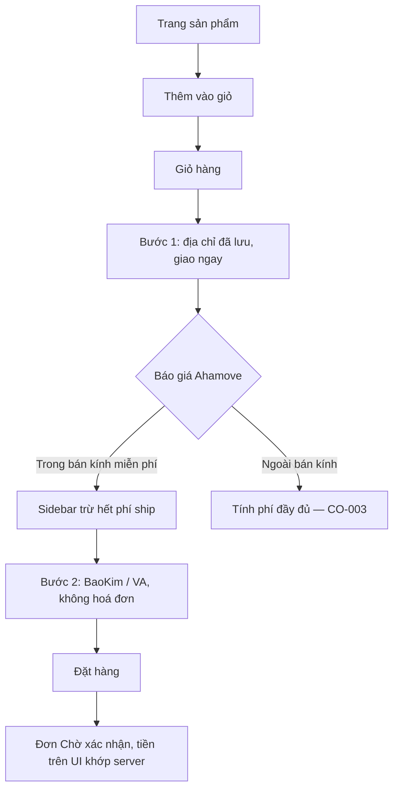

# CO-001 - Đặt hàng với địa chỉ đã lưu và được miễn phí vận chuyển

> **Layer:** E2E · **Status:** Implemented · **Spec:** `e2e/create-order/co-001-saved-address-baokim.spec.ts`

Bảo vệ luồng mua hàng mặc định: khách chọn địa chỉ đã lưu, giao ngay, không xuất hoá đơn,
nằm trong bán kính miễn phí ship, thanh toán qua BaoKim. Đây là luồng tham chiếu mà mọi
case còn lại đều là biến thể của nó.

## Bắt đầu

- Sản phẩm fixture còn hàng.
- Tài khoản đã đăng nhập.
- Tài khoản có địa chỉ đã lưu nằm trong bán kính miễn phí ship.

## Quy trình

1. Thêm sản phẩm vào giỏ.
2. Mở checkout từ giỏ hàng.
3. Chọn địa chỉ đã lưu và ghi chú đơn hàng.
4. Sang bước thanh toán, giữ nguyên mặc định (giao ngay, BaoKim/VA, không hoá đơn).
5. Đặt hàng.

## Kỳ vọng

- Sidebar hiện dòng giảm giá miễn phí ship bằng đúng phí Ahamove; tổng tiền không gồm phí ship.
- Payload mang đúng địa chỉ đã chọn, `orderTime = 0` và `tagIds` rỗng.
- Đơn được tạo; chi tiết đơn và dữ liệu đọc lại qua API khớp với số tiền khách đã nhìn thấy.
- Chỉ có đúng một request tạo đơn.

## Lỗi / regression cần bắt

- Địa chỉ gửi lên không phải địa chỉ khách đã chọn.
- Miễn phí ship không được áp dụng, hoặc áp sai số tiền.
- Client và server lệch nhau ở phí ship / VAT / tổng tiền.
- Một lần bấm đặt hàng tạo ra hai đơn.
