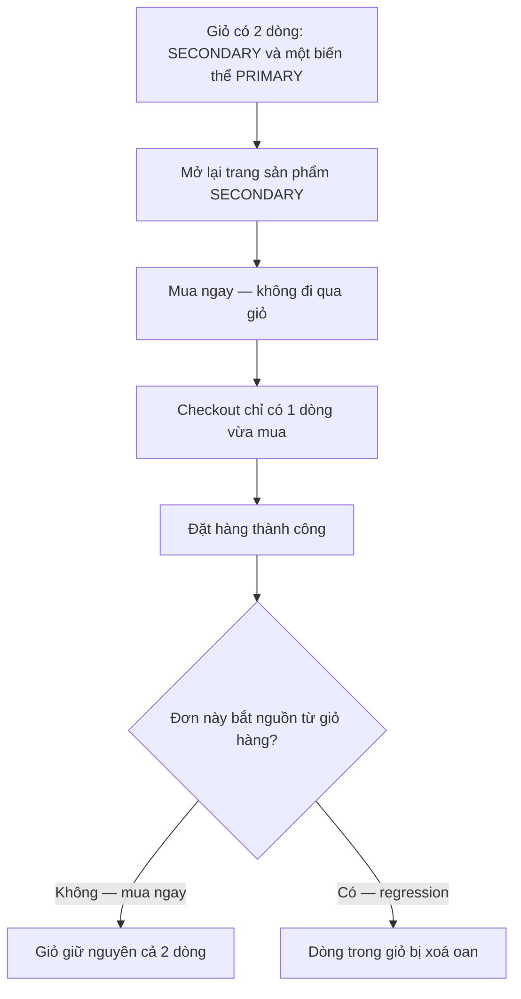

# CO-007 - Mua ngay không làm thay đổi giỏ hàng

> **Layer:** E2E · **Status:** Implemented (chỉ phần "Mua ngay không đụng giỏ hàng"; các nhánh guard còn lại là Deferred) · **Spec:** `e2e/create-order/co-007-checkout-entry-guards.spec.ts`

Đơn tạo từ "Mua ngay" không được xoá bất kỳ dòng nào trong giỏ. Việc dọn giỏ chỉ được phép
xảy ra khi checkout xuất phát từ giỏ hàng - đối xứng với [CO-006](./CO-006-multiline-partial-cart.md).

## Bắt đầu

- Giỏ có sẵn hai dòng, trong đó một dòng trùng đúng sản phẩm sắp mua ngay (để phát hiện được
  việc xoá theo dòng), dòng còn lại hoàn toàn không liên quan.
- Tài khoản đã đăng nhập.
- Địa chỉ đã lưu nằm trong bán kính miễn phí ship.

## Quy trình

1. Nạp hai dòng vào giỏ và xác nhận cả hai đang có mặt.
2. Mở trang sản phẩm và bấm **Mua ngay**.
3. Hoàn tất checkout và đặt hàng.
4. Quay lại giỏ hàng.

## Kỳ vọng

- Sidebar checkout chỉ có dòng mua ngay, không kéo theo dòng nào đang nằm trong giỏ.
- Đơn được tạo với đúng một dòng hàng.
- Cả hai dòng trong giỏ còn nguyên, đúng số lượng cũ.

## Lỗi / regression cần bắt

- Mua ngay xoá mất dòng giỏ hàng trùng sản phẩm - khách mất hàng mà không có cảnh báo nào.
- Checkout xoá sạch giỏ sau khi đặt hàng.
- Checkout mua ngay gộp nhầm các dòng đang có trong giỏ vào đơn.
