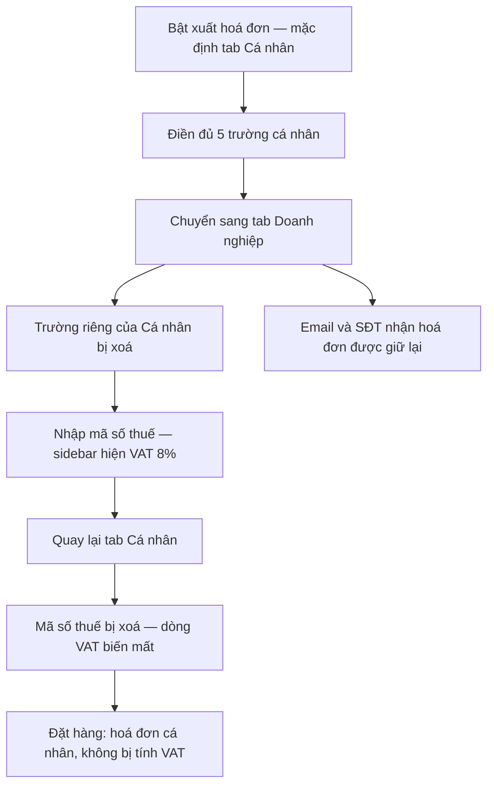

# CO-009 - Đổi loại hoá đơn xoá dữ liệu của loại vừa rời đi

> **Layer:** E2E · **Status:** Implemented · **Spec:** `e2e/create-order/co-009-invoice-tab-switch.spec.ts`

Regression cho một bản vá pricing đã lên production: khi khách đổi tab loại hoá đơn, dữ liệu
riêng của loại vừa rời phải bị xoá, còn email và số điện thoại nhận hoá đơn - vốn bắt buộc ở
cả hai loại - thì được giữ lại.

## Bắt đầu

- Sản phẩm fixture còn hàng, tài khoản đã đăng nhập.
- Địa chỉ đã lưu nằm trong bán kính miễn phí ship.
- Có mã số thuế công ty hợp lệ; API tra cứu mã số thuế được chặn.

## Quy trình

1. Vào checkout tới bước thanh toán.
2. Bật hoá đơn (mặc định là Cá nhân) và điền đủ năm trường.
3. Chuyển sang Công ty, nhập mã số thuế.
4. Quay lại Cá nhân và điền lại các trường.
5. Đặt hàng.

## Kỳ vọng

- Email và số điện thoại nhận hoá đơn được giữ qua mọi lần đổi tab.
- Các trường riêng của hoá đơn cá nhân bị xoá khi rời tab và không tự sống lại khi quay về.
- Sau khi quay lại Cá nhân, dòng VAT 8% biến mất khỏi sidebar.
- Payload mang `invoiceType: Personal` và `taxCode: null`; server trả `vatFee = 0`.

## Lỗi / regression cần bắt

- Mã số thuế còn sót lại khiến hoá đơn cá nhân bị tính VAT 8% - khách bị thu thừa tiền.
- Trường của loại hoá đơn cũ lọt vào payload.
- Chỉ kiểm tra sidebar là không đủ: payload vẫn có thể sạch trong khi form đã hỏng, nên phải
  kiểm tra cả giá trị các trường lẫn body request.
