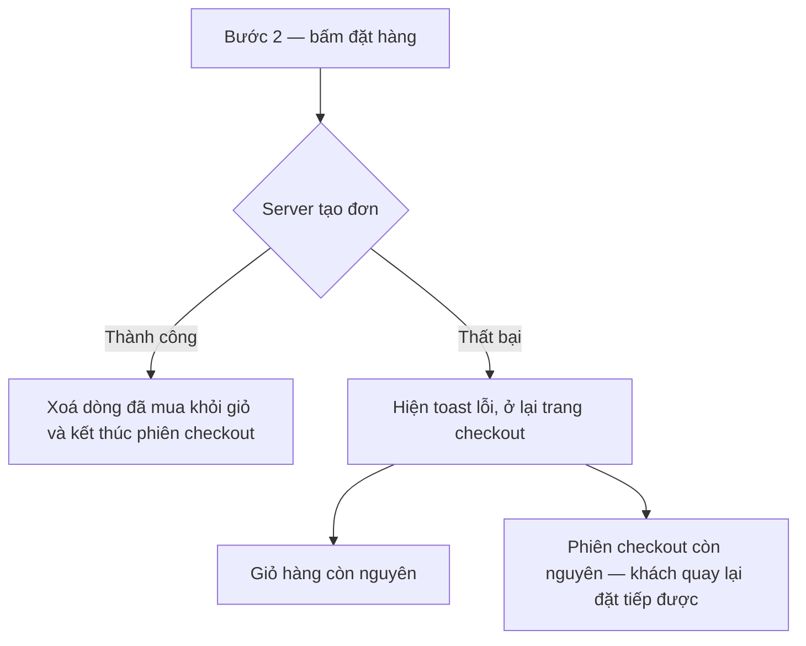

# CO-012 - Tạo đơn thất bại vẫn giữ nguyên giỏ hàng và phiên checkout

> **Layer:** E2E · **Status:** Implemented (chỉ nhánh tạo đơn lỗi; điều hướng lùi và báo giá lỗi là Deferred) · **Spec:** `e2e/create-order/co-012-step-navigation-failures.spec.ts`

Mọi thao tác dọn dẹp - xoá dòng giỏ, xoá phiên checkout, chuyển trang - chỉ được chạy **sau
khi** tạo đơn thành công. Tạo đơn lỗi thì khách không được mất gì.

## Bắt đầu

- Sản phẩm fixture còn hàng, tài khoản đã đăng nhập.
- Địa chỉ đã lưu; checkout xuất phát **từ giỏ hàng** (nhánh thực sự có dọn giỏ).
- API tạo đơn bị chặn và trả 500.

## Quy trình

1. Thêm sản phẩm vào giỏ và mở checkout.
2. Chọn địa chỉ, sang bước thanh toán với báo giá Ahamove thật.
3. Bật chặn 500 cho API tạo đơn rồi bấm đặt hàng.
4. Kiểm tra giỏ hàng, rồi quay lại checkout.

## Kỳ vọng

- Đúng một lần gọi tạo đơn, toast báo không tạo được đơn, URL vẫn ở `/checkout`.
- Giỏ hàng còn nguyên dòng sản phẩm với số lượng cũ.
- Quay lại `/checkout` vẫn thấy đơn hàng chứ không bị đẩy về giỏ - đó là cách quan sát phiên
  checkout còn sống.

## Lỗi / regression cần bắt

- Đơn lỗi vẫn xoá dòng giỏ: khách mất giỏ hàng mà không có đơn nào để bù lại.
- Phiên checkout bị xoá nên khách không thể thử lại.
