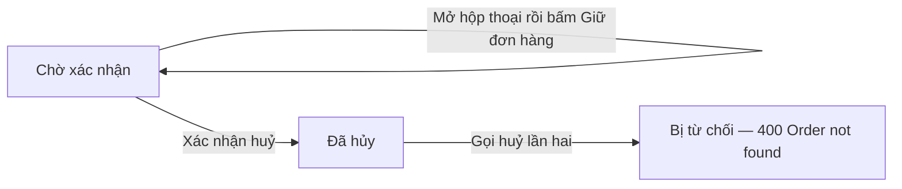

# CO-015 - Khách huỷ được đơn đang chờ thanh toán

> **Layer:** E2E · **Status:** Implemented · **Spec:** `e2e/create-order/co-015-cancel-pending-baokim.spec.ts`

Chủ đơn huỷ được đơn đang chờ của mình; đơn đã huỷ thì không thanh toán lại và không huỷ lần
hai được. Đây là chuyển trạng thái duy nhất đi được mà không cần thanh toán thật.

## Bắt đầu

- Sản phẩm fixture còn hàng, tài khoản đã đăng nhập.
- Địa chỉ đã lưu nằm trong bán kính miễn phí ship.

## Quy trình

1. Tạo một đơn ở trạng thái chờ.
2. Mở hộp thoại xác nhận huỷ rồi **thoát ra**.
3. Mở lại và xác nhận huỷ.
4. Gọi huỷ lần hai qua API.

## Kỳ vọng

- Thoát hộp thoại thì đơn không thay đổi gì, cả trên giao diện lẫn qua API.
- Sau khi xác nhận: trạng thái đã huỷ, có banner và mốc thời gian huỷ, mất nút thanh toán và
  nút huỷ.
- API trả trạng thái `Cancelled`, không có giao dịch, các trường Ahamove trống.
- Huỷ lần hai bị từ chối với **400 "Order not found"** (server gộp điều kiện trạng thái vào
  câu truy vấn, nên không phải 404 hay 409).

## Lỗi / regression cần bắt

- Nút huỷ tự huỷ đơn ngay khi bấm mở hộp thoại - hộp thoại chỉ là trang trí.
- Đơn đã huỷ vẫn thanh toán được.
- Mã lỗi của lần huỷ thứ hai đổi mà không ai biết.
