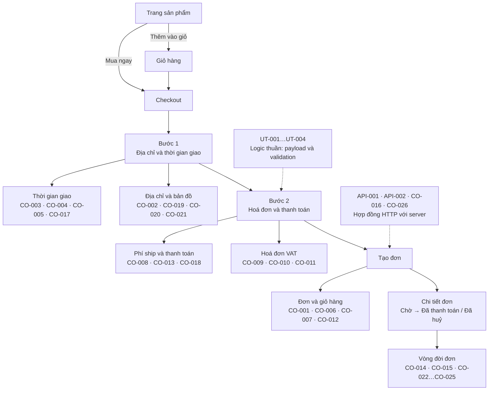

# Create Order - bộ test case

Tài liệu này là mục lục của toàn bộ test case cho luồng đặt hàng. Mỗi case có một file
`CO-XXX-*.md` / `API-XXX-*.md` riêng trong thư mục này. Lý do kỹ thuật sâu hơn nằm ở
[`COVERAGE-PLAN-v2.md`](./COVERAGE-PLAN-v2.md).

## Ba tầng test, ba câu hỏi khác nhau

| Tầng                      | Câu hỏi                                                        | Thời gian chạy  | Đỏ khi nào                                            |
| ------------------------- | -------------------------------------------------------------- | --------------- | ----------------------------------------------------- |
| **UT-xxx** - Unit         | Logic nghiệp vụ thuần có đúng không?                           | ~ms             | Một hàm thuần trả về sai giá trị                      |
| **API-xxx** - Integration | Ứng dụng có tích hợp đúng hợp đồng nội bộ và bên thứ ba không? | ~giây, chỉ HTTP | Client và server bất đồng về payload, phí, hoặc quyền |
| **CO-xxx** - E2E          | Khách hàng thật có hoàn tất được hành trình mua hàng không?    | ~1–2 phút       | Khách không mua được, hoặc bị tính sai tiền           |

Thêm test unit **không bao giờ** xoá một case E2E. Nó chỉ thu nhỏ case E2E lại còn đúng phần
cần tới trình duyệt và server thật.

> `CO-016` và `CO-026` mang ID `CO-` nhưng thuộc **tầng API** - cột "Tầng" trong bảng dưới là
> nguồn thông tin đúng, không phải tiền tố ID.

## Luồng khách hàng và chỗ được phủ



## Bảng test case

Dải `CO-` được xếp để **CO-001 … CO-016 là các case đã có spec và đang chạy**, liên tục, không
có lỗ. Các case chưa viết được giữ nguyên ý nghĩa và nằm gọn ở cuối dải, từ CO-017 trở đi.

### A. Case đang chạy - CO-001 … CO-016

| ID     | Kịch bản                                                        | Tầng | Trạng thái  |
| ------ | --------------------------------------------------------------- | ---- | ----------- |
| CO-001 | Đặt hàng với địa chỉ đã lưu và được miễn phí vận chuyển         | E2E  | Implemented |
| CO-002 | Đặt hàng với địa chỉ nhập thủ công                              | E2E  | Implemented |
| CO-003 | Đặt hàng hẹn ngày giao kèm hoá đơn VAT công ty                  | E2E  | Implemented |
| CO-004 | Đặt hàng hẹn ngày giao kèm hoá đơn VAT cá nhân                  | E2E  | Implemented |
| CO-005 | Đặt hàng giao trong ngày theo khung giờ                         | E2E  | Implemented |
| CO-006 | Đặt một phần giỏ hàng thành đơn nhiều sản phẩm                  | E2E  | Implemented |
| CO-007 | Mua ngay không làm thay đổi giỏ hàng                            | E2E  | Implemented |
| CO-008 | Mất cấu hình ngưỡng miễn phí ship                               | E2E  | Known Gap   |
| CO-009 | Đổi loại hoá đơn xoá dữ liệu của loại vừa rời đi                | E2E  | Implemented |
| CO-010 | Hoá đơn công ty thiếu thông tin bắt buộc                        | E2E  | Implemented |
| CO-011 | Hoá đơn cá nhân thiếu thông tin bắt buộc                        | E2E  | Implemented |
| CO-012 | Tạo đơn thất bại vẫn giữ nguyên giỏ hàng và phiên checkout      | E2E  | Implemented |
| CO-013 | Phương thức thanh toán luôn đi theo cổng thanh toán             | E2E  | Implemented |
| CO-014 | Đơn bỏ dở thanh toán vẫn giữ nguyên trạng thái chờ              | E2E  | Implemented |
| CO-015 | Khách huỷ được đơn đang chờ thanh toán                          | E2E  | Implemented |
| CO-016 | Server tự quyết phí giao hàng và giới hạn ngày giao khi tạo đơn | API  | Implemented |

### B. Case chưa chạy - CO-017 … CO-026

Vẫn giữ tài liệu, vẫn giữ ID. **Không** case nào ở đây được tính là đã phủ.

| ID     | Kịch bản                                         | Tầng        | Trạng thái | Vì sao chưa chạy                            |
| ------ | ------------------------------------------------ | ----------- | ---------- | ------------------------------------------- |
| CO-017 | Đặt hàng chọn ngày, không chọn khung giờ         | E2E         | Deferred   | Cần một lượt Tier B thủ công mới có giá trị |
| CO-018 | Địa chỉ nằm đúng ranh giới miễn phí ship         | E2E         | Blocked    | Chưa ghim được ngưỡng và khoảng cách        |
| CO-019 | Chặn bước 1 khi thông tin giao hàng không hợp lệ | E2E         | Deferred   | Viết được, chưa tới lượt ưu tiên            |
| CO-020 | Đổi địa chỉ giao hàng trong checkout             | E2E         | Deferred   | Nặng fixture, chưa tới lượt ưu tiên         |
| CO-021 | Ghim bản đồ và reverse geocode                   | E2E         | Deferred   | Dễ flaky nhất, cần chốt cách drive bản đồ   |
| CO-022 | Webhook SePay xác nhận thanh toán thành công     | Integration | Blocked    | Webhook SePay hỏng và không có trong repo   |
| CO-023 | Webhook SePay không được gửi                     | Integration | Blocked    | Như trên                                    |
| CO-024 | Webhook SePay gửi trùng                          | Integration | Blocked    | Như trên                                    |
| CO-025 | Webhook SePay không hợp lệ                       | Integration | Blocked    | Như trên                                    |
| CO-026 | Huỷ đơn của tài khoản khác                       | API         | Blocked    | Chưa có tài khoản test thứ hai              |

### C. API (`API-`)

| ID      | Kịch bản                                                      | Tầng | Trạng thái  |
| ------- | ------------------------------------------------------------- | ---- | ----------- |
| API-001 | Sản phẩm fixture còn bán được và tìm thấy trên trang sản phẩm | API  | Implemented |
| API-002 | Chặn được API geocode autocomplete                            | API  | Temporary   |

### D. Unit (`UT-`)

Không có file case riêng - code test nằm cạnh source, mô tả nằm ở `COVERAGE-PLAN-v2.md` §4.
Chạy bằng `pnpm run test:unit`.

| ID     | Kịch bản                                     | Tầng | Trạng thái  | File                                  |
| ------ | -------------------------------------------- | ---- | ----------- | ------------------------------------- |
| UT-001 | Lọc trường hoá đơn khi dựng payload checkout | Unit | Implemented | `features/orders/payloads.test.ts`    |
| UT-002 | Ánh xạ trường khi dựng payload báo giá       | Unit | Implemented | `features/orders/payloads.test.ts`    |
| UT-003 | Ma trận trường bắt buộc của hoá đơn          | Unit | Implemented | `features/orders/validations.test.ts` |
| UT-004 | Quy tắc kiểm tra dữ liệu ở bước 1            | Unit | Implemented | `features/orders/validations.test.ts` |
| UT-005 | Chọn kết quả geocode và chuẩn hoá địa chỉ    | Unit | Deferred    | -                                     |
| UT-006 | Chuẩn hoá kết quả tra cứu mã số thuế         | Unit | Deferred    | -                                     |
| UT-007 | Các hàm tiện ích của chính bộ test           | Unit | Deferred    | -                                     |

### Ý nghĩa trạng thái

- **Implemented** - đã có spec và đang chạy.
- **Blocked** - không viết được vì thiếu môi trường, dữ liệu hoặc tài khoản. Giữ tài liệu lại.
- **Deferred** - viết được nhưng chưa ưu tiên.
- **Known Gap** - spec đã có và đang **pin hành vi hiện tại chưa đúng ý**, không phải hành vi mong muốn.
- **Temporary** - scaffolding, sẽ xoá khi không cần nữa.

## Code test nằm ở đâu

Mỗi spec chỉ nên chứa phần _kịch bản_. Mọi thứ dùng chung nằm ở bốn chỗ dưới đây - thêm cái
mới vào đúng chỗ, đừng viết lại trong spec.

| Nơi                   | Chứa gì                                                                                    |
| --------------------- | ------------------------------------------------------------------------------------------ |
| `e2e/pages/*.page.ts` | Locator và hành động của người dùng. Locator mới phải vào đây, không viết thẳng trong spec |
| `e2e/fixtures/*.ts`   | Dữ liệu cố định dùng chung: sản phẩm, địa chỉ, hoá đơn, ghi chú đơn hàng                   |
| `e2e/api/*.ts`        | Đọc và kiểm tra dữ liệu qua HTTP (đọc lại đơn, đối chiếu tiền, tra cấu hình)               |
| `e2e/utils/*.ts`      | Tiện ích của bộ test: đếm request, thời gian giao, tiền tệ, popup khuyến mãi               |

Vài chỗ hay dùng nhất:

- `products.addFixtureToCart(PRIMARY_PRODUCT)` - tìm, mở, chọn biến thể, thêm vào giỏ; trả về
  nhãn của dòng trong giỏ.
- `checkout.goToPaymentCapturingQuote()` - sang bước 2 và bắt lấy báo giá Ahamove
  (payload, danh sách dịch vụ, dịch vụ rẻ nhất được chọn sẵn).
- `countPostsTo(page, CREATE_ORDER_PATH)` - đếm request của **chính trang này**. Đây là cách
  duy nhất được phép để khẳng định "checkout không gọi API X", vì cả suite dùng chung một tài
  khoản (rủi ro #8).
- `expectServerTotalsMatchUi(page, orderId, uiTotals)` - assertion mạnh nhất của suite: số
  tiền khách nhìn thấy đúng bằng số tiền server tính.

## Suite chạy theo hai tier

**Tier A - tự động, không thanh toán.** Mọi case ở trên trừ khối Tier B. Chạy không cần người:

```
npx playwright test e2e/create-order --project=chromium
```

**Tier B - thủ công.** Bật `E2E_WAIT_FOR_PAYMENT=1` thì CO-001…CO-005 sẽ dừng ở trang
chi tiết đơn và chờ người thanh toán qua BaoKim, rồi mới kiểm tra đơn đã thanh toán. Khi cờ này
bật, fixture **không** huỷ đơn nào của lượt chạy, nên phải huỷ tay sau đó hoặc đơn vẫn còn thanh
toán được.

Callback của BaoKim được ký RSA bằng khoá riêng của BaoKim, nên test không thể giả mạo thanh
toán. Tier B là con đường duy nhất tới đơn `Paid`, và nó cần một người thật.

Chạy một spec:

```
npx playwright test e2e/create-order/co-0NN-*.spec.ts --project=chromium
```

## SePay đang ngừng phục vụ

Webhook SePay đang hỏng nên không case nào đặt đơn qua SePay. CO-004 vốn viết cho SePay đã được
chuyển sang BaoKim thay vì xoá - kịch bản của nó (địa chỉ nhập tay + hẹn giờ + hoá đơn cá nhân +
ship tính phí) không được phủ ở đâu khác.

Hai phần được tách ra chứ không mất: phần ràng buộc cổng/phương thức thanh toán thành **CO-013**
(logic thuần client nên vẫn có giá trị), còn phần panel QR của SePay giờ chỉ còn trong tài liệu.

CO-022…CO-025 giữ nguyên và ở trạng thái **Blocked**.

## Backend thực sự làm gì

Đã đối chiếu với `/Users/dahn/Workspace/dotnet/hoatheomua-be`. Những điểm này chi phối nhiều
assertion trong suite.

1. **Server tự tính lại mọi khoản phí và bỏ qua số client gửi.** `CreateOrderRequest` không hề
   có trường `shippingFee`, `vatFee`, `totalFee` hay `productFee`. Tiền hàng lấy từ catalogue
   Nhanh.vn, phí ship từ báo giá Ahamove sống, VAT từ mã số thuế. Assertion quan trọng nhất là
   "số tiền khách nhìn thấy đúng bằng số tiền đơn được tạo ra".
2. **VAT bám theo mã số thuế, không theo công tắc xuất hoá đơn.** Có mã số thuế thì `vatFee` =
   `productFee * 0.08`, không có thì `0`, bất kể `isExportInvoice`. Nên hoá đơn cá nhân không có
   VAT - xem CO-004.
3. **Quy tắc miễn phí ship khớp nhau ở hai phía.** Client `distanceKm <= freeShipKm`, server
   `Distance <= freeShipping`. CO-018 kiểm tra đúng điểm bằng nhau.
4. **Chỉ có ba trạng thái và không có trạng thái thất bại.** `Pending`, `Paid`, `Cancelled`.
   Không có gì làm hết hạn một đơn chờ, nên thanh toán thất bại và bỏ ngang là không phân biệt
   được - đó chính là điều CO-014 chốt lại.
5. **Huỷ đơn gộp điều kiện vào câu truy vấn.** Lọc `Id == id && Status == "Pending"`, nên đơn đã
   thanh toán hoặc đã huỷ đều trả **400 "Order not found"**, không phải 404 hay 409 - CO-015 pin
   điều này.
6. **Đơn hẹn giờ không bao giờ được tự động điều xe.** Ahamove chỉ được đặt trong webhook thanh
   toán và chỉ khi `orderTime == 0 && tagIds == []`. Mọi đơn hẹn giờ đều do nhân viên đặt tay -
   CO-003, CO-004, CO-005 kiểm tra các trường theo dõi phải rỗng.
7. **`Paid` và booking Ahamove commit cùng một lần**, nên các trường theo dõi đã có sẵn ngay khi
   trạng thái đổi.
8. **Lỗi validation không kèm chi tiết trường ngoài môi trường Development**, nên CO-016 chỉ kiểm
   tra `status` và `messageCode`.

## Rủi ro đang mở

1. **`tagIds` không được kiểm tra lúc tạo đơn.** Quy tắc bị comment trong validator; chỗ duy nhất
   kiểm tra là webhook thanh toán. Một khung giờ sai được nhận, khách trả tiền, rồi webhook mới
   vỡ - đơn kẹt `Pending` còn tiền thì đã đi. CO-016 pin hành vi này để nó không thành truyền miệng.
2. **Huỷ đơn không kiểm tra chủ sở hữu.** Chỉ lọc theo `Id`, nên bất kỳ khách nào đã đăng nhập
   cũng huỷ được đơn của người khác. Cần tài khoản test thứ hai để chứng minh - CO-026.
3. **Webhook thanh toán làm hết I/O ra ngoài trước lần `SaveChangesAsync` duy nhất.** Nếu Ahamove
   hoặc Nhanh.vn lỗi thì không có gì được lưu: đơn vẫn `Pending`, không có giao dịch, dù tiền đã
   chuyển.
4. **URL trả về của BaoKim bị hardcode** về `hoa-theo-mua.vercel.app`. Chạy Tier B trên host khác
   sẽ bị chuyển ra khỏi origin sau khi thanh toán. Các spec không đi theo redirect nên vẫn pass -
   đừng thêm assertion đi theo nó.
5. **Nút đặt hàng thỉnh thoảng nuốt cú click đầu tiên.** Không request, không toast, không lỗi
   console, và cú click thứ hai thì bình thường. Đây là một race trong form checkout, chưa được sửa.
   - Trên luồng thành công, click bị nuốt làm test timeout - ồn ào, không im lặng.
   - Trên luồng âm, nó **giống hệt** một submit bị chặn đúng. CO-010 và CO-011 xử lý bằng cách
     kiểm tra lỗi inline và toast **trước** khi đếm số request, vì cả hai chỉ xuất hiện khi submit
     thật sự được xử lý. Mọi case âm sau này phải làm y như vậy.
   - `CheckoutPage.placeOrder` **không** retry và **không** đếm request. Việc đếm request thuộc về
     từng spec, dùng listener riêng của page - an toàn khi chạy song song.
6. **Checkout không có `data-testid` nào.** Mọi locator đều là tên tiếng Việt lấy từ
   `lib/i18n/messages/vi.json`, nên đổi chữ trong file dịch sẽ làm test hỏng âm thầm.
7. **Test tạo ra đơn hàng thật, tồn tại lâu dài, trên môi trường thật.** Mọi đơn đều mang ghi chú
   `DEV TEST - Không xử lý đơn hàng này.` và fixture huỷ chúng khi teardown - trừ khi bật
   `E2E_WAIT_FOR_PAYMENT=1`.
8. **Toàn suite dùng chung một tài khoản**, nên không được assert bất kỳ trạng thái nào ở phạm vi
   tài khoản (số địa chỉ, số đơn, giỏ hàng của spec khác). Quy tắc "checkout không được lưu địa
   chỉ" được kiểm tra bằng bộ đếm request trên `POST /api/v1/addresses`, vừa an toàn khi chạy song
   song vừa chính xác hơn.
   - **Locator cũng dính luật này.** CO-015 từng dùng `page.getByText('Đã hủy đơn hàng')` cho
     toast báo huỷ thành công. Huỷ xong trang nhảy về `/orders`, mà **mỗi đơn đã huỷ trong lịch
     sử đều render đúng chuỗi đó**, nên locator trúng nhiều phần tử và vỡ strict mode ngay khi
     tài khoản có vài đơn đã huỷ - nó chỉ xanh khi tài khoản còn sạch. Toast phải khoanh vào
     `[data-sonner-toast]` (`OrderPage.cancelledToast`). Một locator "đúng nội dung" vẫn có thể
     là một assertion phụ thuộc trạng thái tài khoản.

## Chưa rõ / cần xem lại

- Vì sao webhook SePay hỏng, và CO-022…CO-025 có hồi sinh được không.
- Có sandbox BaoKim ngoài production không, để Tier B chạy tự động được.
- Giá trị thật của `ahamove.free_ship`, và có ghim được ở môi trường test không - đó là thứ mở
  khoá CO-018.

## Lịch sử đổi số ID

Dải `CO-` đã được đánh lại hai lần. Bảng dưới tra ngược từ ID hiện tại về các ID cũ, dùng khi
đọc tài liệu hoặc commit cũ. `UT-` và `API-` chưa bao giờ đổi số.

- **Lần 1 - 2026-08-20.** Gom theo giai đoạn của hành trình mua hàng thay vì theo thứ tự lịch
  sử, và bỏ kiểu ID có hậu tố chữ (`CO-024a` / `CO-024b`).
- **Lần 2 - 2026-08-20.** Dồn toàn bộ case **đã có spec** lên đầu dải, thành CO-001 … CO-016
  liên tục; case chưa chạy lùi về CO-017 … CO-026 và giữ nguyên trạng thái Deferred / Blocked.

| ID hiện tại | ID lần 1 | ID gốc  | Kịch bản                              |
| ----------- | -------- | ------- | ------------------------------------- |
| CO-001      | CO-001   | CO-001  | Địa chỉ đã lưu                        |
| CO-002      | CO-002   | CO-002  | Địa chỉ nhập thủ công                 |
| CO-003      | CO-003   | CO-003  | Hẹn giờ + hoá đơn công ty             |
| CO-004      | CO-004   | CO-004  | Hẹn giờ + hoá đơn cá nhân             |
| CO-005      | CO-005   | CO-013  | Khung giờ trong ngày                  |
| CO-006      | CO-007   | CO-022  | Giỏ hàng nhiều dòng                   |
| CO-007      | CO-008   | CO-020  | Mua ngay                              |
| CO-008      | CO-010   | CO-026  | Mất cấu hình miễn phí ship            |
| CO-009      | CO-011   | CO-018  | Đổi loại hoá đơn                      |
| CO-010      | CO-012   | CO-007  | Hoá đơn công ty thiếu trường          |
| CO-011      | CO-013   | CO-017  | Hoá đơn cá nhân thiếu trường          |
| CO-012      | CO-015   | CO-021  | Tạo đơn thất bại                      |
| CO-013      | CO-018   | CO-015  | Cổng / phương thức thanh toán         |
| CO-014      | CO-019   | CO-008  | Bỏ dở thanh toán                      |
| CO-015      | CO-020   | CO-014  | Huỷ đơn đang chờ                      |
| CO-016      | CO-025   | CO-016  | Hợp đồng API tạo đơn                  |
| CO-017      | CO-006   | CO-019  | Chỉ chọn ngày                         |
| CO-018      | CO-009   | CO-005  | Ranh giới miễn phí ship               |
| CO-019      | CO-014   | CO-023  | Kiểm tra dữ liệu bước 1               |
| CO-020      | CO-016   | CO-024a | Đổi địa chỉ trong checkout            |
| CO-021      | CO-017   | CO-024b | Ghim bản đồ                           |
| CO-022      | CO-021   | CO-009  | Webhook SePay thành công              |
| CO-023      | CO-022   | CO-010  | Webhook SePay không tới               |
| CO-024      | CO-023   | CO-011  | Webhook SePay trùng                   |
| CO-025      | CO-024   | CO-012  | Webhook SePay không hợp lệ            |
| CO-026      | CO-026   | CO-025  | Huỷ đơn chéo tài khoản                |
| -           | -        | CO-006  | **Đã đóng** - gộp vào CO-003 / CO-004 |

`COVERAGE-PLAN.md` (bản v1, đã bị thay thế) vẫn dùng cột **ID gốc** và được giữ lại làm tư liệu
lịch sử - tra bảng trên khi đọc nó.
